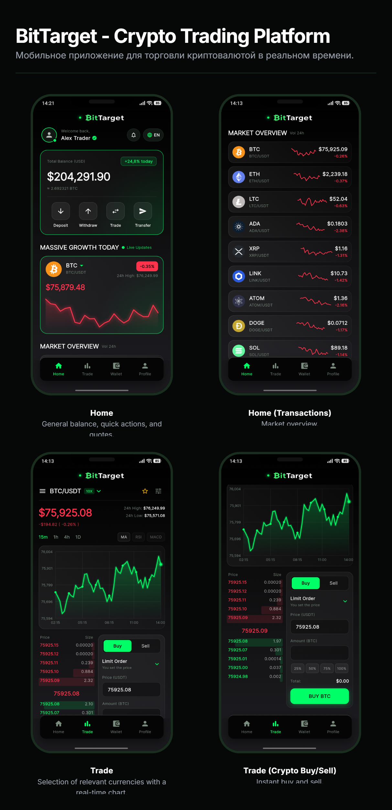
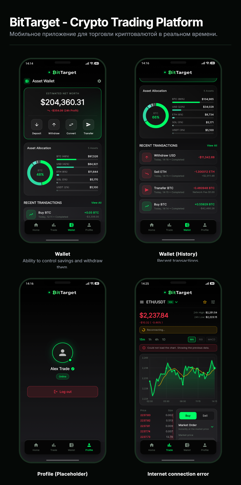

<p align="center">
  
</p>

<p align="center"><b>English</b> | <a href="README.ru.md">Русский</a></p>

<p align="center">
  A crypto trading simulator built with Flutter: live market data, an interactive chart, an order book and a demo wallet.
</p>

<p align="center">
  
  
  
  
</p>

Market data is real and live (public Binance API), while the money is simulated: you get a demo wallet, a trading screen with an interactive chart and order book, and a portfolio overview. It is a portfolio project focused on clean architecture, real-time data and graceful handling of failures.

> Prices come from Binance public endpoints. No API key is needed and no real money is involved.

## Screenshots

<table>
  <tr>
    <td width="50%"></td>
    <td width="50%"></td>
  </tr>
</table>

## Demo

<!--
  

https://github.com/user-attachments/assets/8180dbeb-c2b1-494c-a7cb-910626179b46


https://github.com/user-attachments/assets/addca212-77cc-4d3b-9c5a-21c9d6061651


-->

<table>
  <tr>
    <td width="50%"><video src="PASTE_VIDEO_1_LINK_HERE" controls muted width="100%"></video></td>
    <td width="50%"><video src="PASTE_VIDEO_2_LINK_HERE" controls muted width="100%"></video></td>
  </tr>
</table>

## Features

### Home
- Total balance calculated from the wallet and live prices, with the BTC equivalent
- Featured coin card with a live chart and the 24h high, switchable from a coin picker
- Market overview of the tracked coins with mini charts, refreshed every few seconds
- Offline mode: when the connection drops, the last known prices stay and a warning appears
- One-tap quick actions: Deposit, Withdraw, Trade (jumps to the Trade tab) and Transfer
- Language switch (English / Russian) that applies instantly

### Trade
- Pair selector with search, live prices and favourites
- Interactive chart: timeframes 15m / 1h / 4h / 1D, tap or drag to see the exact price and time, moving average (MA) and an optional points overlay
- Live order book over WebSocket, with a REST fallback when the stream is silent
- Order form: Buy / Sell, **limit** and **market** orders, 25/50/75/100% shortcuts, total preview, protection against prices more than 5% from the market
- Tap a price in the order book to copy it into the form
- Connection banner ("Reconnecting...") with automatic reconnection; the screen sleeps when its tab is not visible, so it does not waste traffic

### Wallet
- Estimated net worth and 24h profit calculated from live prices
- Asset allocation donut chart with a legend
- Deposit (dollars or any coin), withdraw (dollars), convert (buy or sell crypto for dollars at the market price) and transfer (send a coin to an address with a network fee)
- Transaction history that updates instantly from every action, including trades made on the Trade tab

### Profile
- Log out / log in. While signed out, navigation is locked: the bottom bar is disabled and swiping between tabs is off

### Quality
- A shared network layer: timeouts, one automatic retry, human-readable error categories (no connection, timeout, server error, rate limit) and a Retry button wherever data cannot load
- Money is stored as integers (cents for dollars, millionths for coins), so rounding errors cannot accumulate
- Responsive layout that survives narrow screens
- 41 unit tests

## Tech stack

| Area | What is used |
|---|---|
| Framework | Flutter, Dart 3 |
| State management | `flutter_bloc` (Cubit): market, trade, wallet, locale, navigation and auth cubits |
| Networking | `dio` with a shared client and a retry interceptor; `web_socket_channel` for live streams |
| Data source | Binance public REST and WebSocket APIs |
| Localization | `flutter_localizations`, `intl`, ARB files with `flutter gen-l10n` (English and Russian) |
| UI | Custom widgets, `CustomPainter` for the charts and the donut, glass-style cards, press effects |
| Fonts and icons | `google_fonts` (Inter), coin icons bundled as assets |
| Testing | `flutter_test` with fake services in place of the network |

## Architecture

The project is organised by feature. Each feature separates **data** (where the information comes from) from **presentation** (how it is shown), and a Cubit sits between them.

```
Binance API -> service (Dio / WebSocket) -> Cubit (state) -> screens and widgets
```

```
lib/
├── main.dart                     app entry, providers
├── main_shell_screen.dart        bottom navigation, page switching, login lock
├── l10n/                         ARB files and generated localizations
├── core/
│   ├── auth/  nav/  locale/      small global cubits
│   ├── network/                  ApiClient (timeouts, retry, error mapping)
│   ├── theme/  constants/        colors, typography
│   ├── utils/                    price formatting, input formatter
│   └── widgets/                  glass card, charts, press effect, shared widgets
└── features/
    ├── home/                     data + presentation
    ├── trade/                    data + presentation
    ├── wallet/                   cubit, portfolio maths, presentation
    └── profile/
test/                             unit tests
assets/                           coin icons and images
docs/                             logo, screenshots for this README
```

Design decisions worth mentioning:

- **One source of truth for the market.** `MarketCubit` feeds the home screen, the wallet valuation and the coin pickers.
- **Failures are part of the design.** Every screen that needs the network has loading, error and data states, a Retry action and a way out (for example, the pair selector stays available on the Trade error screen).
- **Streams that clean up after themselves.** WebSocket connections open only while the Trade tab is visible and close when it is not.
- **Testable logic.** Cubits take their services as constructor arguments, so tests replace the network with fakes.

## Getting started

Requirements: the [Flutter SDK](https://docs.flutter.dev/get-started/install) and a device, emulator or Chrome.

```bash
git clone https://github.com/YOUR_LOGIN/bittarget.git
cd bittarget
flutter pub get
flutter gen-l10n
flutter run -d chrome
```

Run the tests:

```bash
flutter test
```

Binance may be unavailable in some countries or networks. If prices do not load, the app shows an error with a Retry button instead of freezing.

## Testing

The 41 tests cover:

- wallet operations: deposit, withdraw, buy, sell, transfer, insufficient funds, rounding, history limit
- portfolio maths: net worth, 24h profit, allocation shares
- price formatting
- market and trade cubits: loading, errors, retry, switching coins and timeframes
- login lock and tab navigation state

## Roadmap

- Save the wallet on the device, with a "reset wallet" button
- Real pending limit orders with an "open orders" list
- RSI and MACD indicators
- GitHub Actions workflow that runs the tests on every push

## Disclaimer

BitTarget is a demo. It does not trade real assets and is not financial advice.
